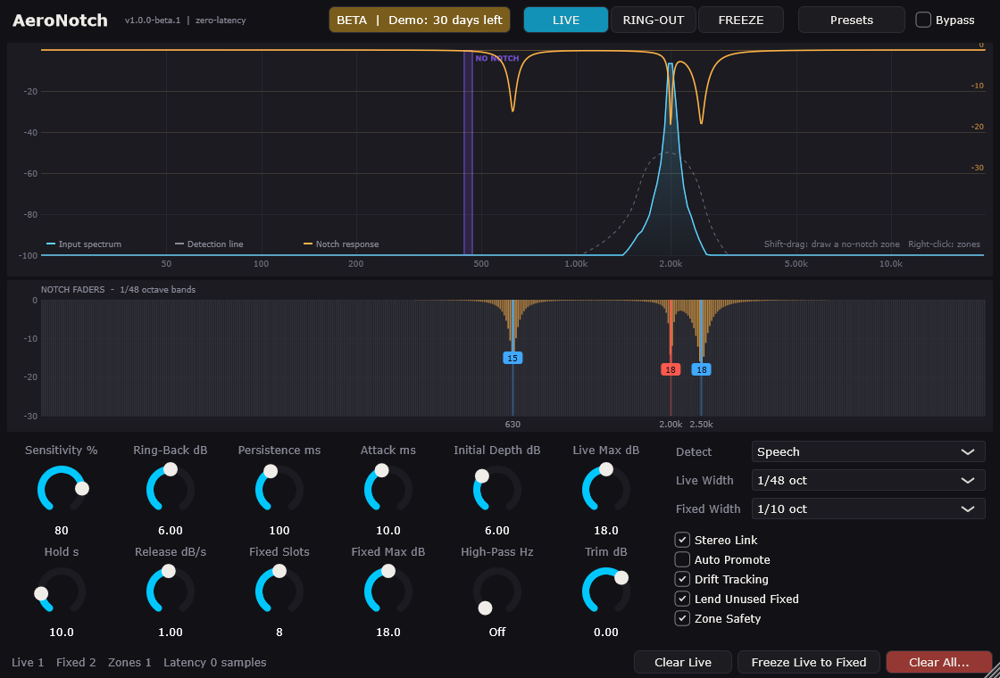
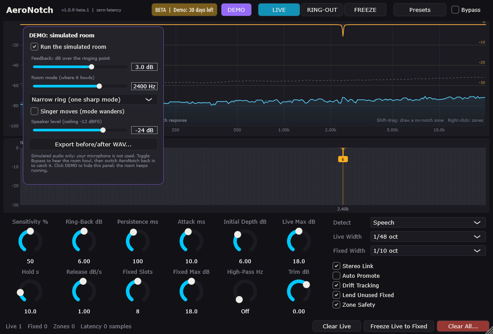

# AeroNotch

**Feedback exterminator plugin for live sound.** Stop the howl, and keep your hands on it.

AeroNotch finds feedback in a fraction of a second and cuts it with notches
narrower than a semitone, adding **0 samples of latency**. Every notch has a
fader, so the engineer always has the final say.

> **Beta.** `1.0.0-beta.1` is fully working, with no time limit in this beta.
> Feedback from real rooms and real rigs is what this beta is for, so please
> tell us how it went:
> support@aeronotch.alphabellsystems.com

## Download

Get the latest build from **[Releases](https://github.com/warlockscript/aeronotch/releases)**.

| Platform | Formats | Status |
|----------|---------|--------|
| Windows 10/11 (64-bit) | VST3, Standalone | **Beta**, validated with Steinberg's VST3 validator |
| macOS (Apple Silicon + Intel) | VST3, AU, Standalone | In testing |
| Linux (64-bit) | VST3, LV2, Standalone | In testing |

## Install (Windows)

**VST3 plugin**
1. Unzip `AeroNotch-...-Windows-VST3.zip`.
2. Copy the `AeroNotch.vst3` folder to `C:\Program Files\Common Files\VST3\`.
3. Rescan plugins in your host (Waves SuperRack Performer, Gig Performer,
   LiveVST, or any VST3 host).

**Standalone app:** unzip `AeroNotch-...-Windows-Standalone.zip` and run
`AeroNotch.exe`. Choose your audio interface under *Options > Audio/MIDI
Settings*; ASIO gives the lowest latency. The app starts with its input
**muted to avoid a feedback loop**. Unmute it there once your speakers and
microphone are set up safely.

No extra runtime or installer is needed.

## How it works

1. **Ring out before the show.** Set the mode to **RING-OUT** and raise the gain
   slowly. Each frequency that starts to ring is locked into the fixed pool.
   Save it with *Presets > Save Venue Preset*.
2. **Live tracking during the show.** Set the mode to **LIVE**. Fixed notches
   stay put; live notches catch whatever the performers' movement causes. They
   hold, then ease back slowly, testing the water. If the frequency rings again,
   they snap straight back.
3. **Your hands on every notch.** Lift any notch with its fader. If the room
   rings again, AeroNotch pulls it back down: a friendly tug-of-war where the
   room keeps the last word.

Notch colours: **red** catching feedback, **amber** holding, **green** easing
off, **blue** fixed (ring-out).

### Keyboard

Click a notch fader, then:

| Key | Action |
|-----|--------|
| Left / Right | select the previous / next notch |
| Up / Down | ease off / deepen it by 1 dB (Shift: 3 dB) |
| Delete | release it |
| L | lock it as a fixed notch |
| Esc | deselect |

### More

- **No-notch zones:** Shift-drag across the analyser to protect a held note or
  an instrument's range. A genuine runaway howl inside a zone is still caught,
  shallowly.
- **Lock badge:** a frequency you keep lifting and the room keeps pulling back
  shows **LOCK**. One click makes it a fixed notch.
- **Linked stereo:** left and right always get identical filters, so the stereo
  image never shifts.
- **Presets:** settings presets, and venue presets that also keep the ring-out
  and zones.

## DEMO mode (Standalone app)

Click **DEMO** to run a simulated room. Make it howl on purpose and watch
AeroNotch catch it, on a laptop, with no PA and no microphone. The output is
capped at -12 dBFS. *Export before/after WAV* saves a 20-second clip for
sharing. DEMO mode is never available inside the plugin.

## Licence and demo

**In beta.1 the 30-day limit is not enforced**, so keep testing as long as you
like. Licence activation arrives in a later beta. When it does, it will work
like this:

- Fully working for **30 days** from first use.
- After that, without a licence, AeroNotch **passes audio through untouched**
  and asks for a licence. It never mutes your system, and it never switches off
  during a show: the check happens only when the plugin loads.
- A licence is a small file, not tied to one computer: a new PC, a reinstall or
  an update all use the same file. Click the **BETA | Demo** chip in the header
  to load it.

## Specs

| | |
|-|-|
| Plugin latency | 0 samples |
| Notch filters | 16 (8 fixed + 8 live by default) |
| Notch width | 1/5 to 1/80 octave (live default 1/48) |
| CPU | about 1.3 % of one core per mono instance with all notches active (measured at 48 kHz; varies by computer) |
| Memory | under 1 MB per instance; no GPU needed |

## Support

support@nullwatch.alphabellsystems.com

AeroNotch is made by MasterPro. The source code is not public.
